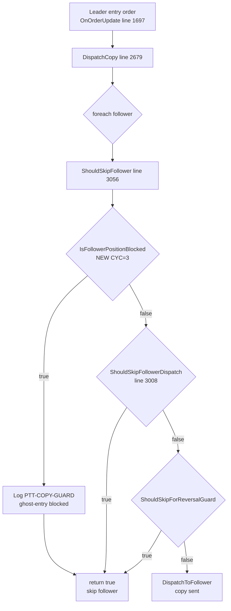
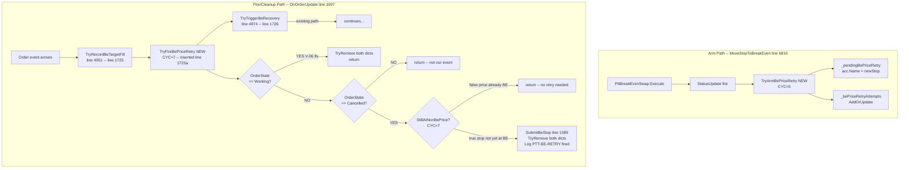

# DW-B159 Architecture Plan — Ghost Re-entry Guard + BE-All Silent Rollback Repair
<!-- status: CORRECTED — all Ph2 violations resolved (pass 3: V-07 V-08 V-09) -->
<!-- wave: B159 -->
<!-- epic: DW-B159 -->
<!-- phase: 1 -->
<!-- author: ptt-architect -->

---

## Violation Resolution Log

| ID   | Previous value            | Corrected value           | Source                          |
|------|---------------------------|---------------------------|---------------------------------|
| V-01 | SubmitBeStop line 451     | **line 1389**             | grep + read_file CopyEngine.cs  |
| V-02 | ArmAllPendingBe line 478  | **line 1482**             | grep + read_file CopyEngine.cs  |
| V-03 | MoveStopToBreakEven line 1542 | **line 6816**         | grep + read_file CopyEngine.cs  |
| V-04 | field anchor "near line 139" | **after line 322**     | read_file lines 278-338         |
| V-05 | StillAtNonBePrice CYC=4   | **CYC=7**                 | branch-by-branch re-count below |
| V-06 | no Working-state path     | **Option (a): TryFireBePriceRetry handles Working** | design below |

---

## LANE-SPLIT GATE — LANES-APPROVED

Standard 4-question evaluation. Source-verified answers below.

| Q  | Question                                                         | Answer |
|----|------------------------------------------------------------------|--------|
| Q1 | Are the two feature modules within 50 lines of each other?       | **NO** — FM-A hooks into `ShouldSkipFollower` (line 3056); FM-B hooks into `OnOrderUpdate` (line 1697) and `MoveStopToBreakEven` (line 6816). Distance = 1359+ lines. |
| Q2 | Does FM-B depend on FM-A's final design?                         | **NO** — FM-B (`_pendingBePriceRetry`, `TryArmBePriceRetry`, `TryFireBePriceRetry`) is entirely independent of FM-A (`IsFollowerPositionBlocked`, `ShouldSkipFollower` hook). |
| Q3 | Does each fix have standalone value if the other is blocked?     | **YES** — FM-A (ghost re-entry guard) delivers standalone protection. FM-B (BE-retry repair) delivers standalone BE-stop recovery. Either can ship alone. |
| Q4 | Does each fix have an independent SIM verification path?         | **YES** — FM-A: `[PTT-COPY-GUARD]` log line verifiable in SIM by opening a follower position and triggering a leader re-entry. FM-B: `[PTT-BE-RETRY]` log line verifiable in SIM by triggering a QX→BE-All then ATM-cancel sequence. |

**Result: LANES-APPROVED.** All new code stays in `src/PropTraderTools/CopyEngine.cs`.

---

## Confirmed Line Numbers (verified by grep + read_file)

| Symbol                      | Exact Line |
|-----------------------------|------------|
| `ShouldSkipFollower`        | 3056       |
| `ShouldSkipFollowerDispatch`| 3008       |
| `HasOpenPosition`           | 5273       |
| `DispatchCopy`              | 2679       |
| `OnOrderUpdate`             | 1697       |
| `TryTriggerBeRecovery`      | 4974       |
| `MoveStopToBreakEven`       | 6816       |
| `ArmAllPendingBe`           | 1482       |
| `SubmitBeStop`              | 1389       |
| `TryRecordBeTargetFill`     | 4951       |
| `_pendingBeSlots` (existing)| 278        |
| field insertion anchor      | after 322 (after `_beReplaceAttempts`) |

---

## Scope

**Single file: `src/PropTraderTools/CopyEngine.cs`** — no other source files modified.
Tests added to existing `src/PropTraderTools/CopyEngineTests.cs`.
No new files created.

---

## Feature Module A — Ghost Re-entry Guard

### Problem

When a follower account already holds an open position on an instrument and the leader submits a new entry in the same direction, `DispatchCopy` → `ShouldSkipFollower` does not currently detect the pre-existing follower position. The copy order fires anyway, doubling the follower's position silently ("ghost re-entry").

### Design

**New method: `IsFollowerPositionBlocked`**

```
// CYC=3: base(1) + acc-null guard(2) + instr-null guard(3)
// Delegates position check to HasOpenPosition (line 5273) -- no duplicate logic.
// JS-001: no throw. JS-021: no lock. JS-042: ASCII-only.
// internal: accessible to xUnit via InternalsVisibleTo.
internal bool IsFollowerPositionBlocked(Account acc, Instrument instr)
{
    if (acc == null)   return false;               // (2)
    if (instr == null) return false;               // (3)
    return HasOpenPosition(acc, instr);
}
```

**CYC breakdown:**
- base = 1
- `acc == null` branch = 1
- `instr == null` branch = 1
- Total = **3** ✓

**Hook in `ShouldSkipFollower` (line 3056) — FIRST statement:**

```csharp
// B159 DW-B159-FM-A: ghost re-entry guard -- block copy when follower already has position.
if (IsFollowerPositionBlocked(acc, instr))
{
    NinjaTrader.Code.Output.Process(
        "[PTT-COPY-GUARD] ghost-entry blocked: " + acc.Name + " " + instr.FullName,
        NinjaTrader.NinjaScript.PrintTo.OutputTab1
    );
    return true;
}
```

This is inserted as the **first** conditional in `ShouldSkipFollower` before the existing `ShouldSkipFollowerDispatch` call.

**`ShouldSkipFollower` CYC after modification:**
- Original CYC = 3 (base + dispatch-check + reversal-check)
- New first branch adds 1 → **CYC = 4** ✓ (within <=8)

**Log marker:** `[PTT-COPY-GUARD] ghost-entry blocked: {acc.Name} {instr.FullName}`
- ASCII-only ✓
- No DateTime.Now ✓
- Exact format — no variation allowed

### FM-A Mermaid Diagram



### FM-A Test Matrix

| Test | Method under test | Stimulus | Expected |
|------|------------------|----------|----------|
| FM-A-T1 | `IsFollowerPositionBlocked` | acc has no positions (Quantity=0) | returns `false` |
| FM-A-T2 | `IsFollowerPositionBlocked` | acc has open position Qty>0 | returns `true` |
| FM-A-T3 | `ShouldSkipFollower` | follower has open position on instrument | returns `true` (blocked) |
| FM-A-T4 | `ShouldSkipFollower` | follower is flat on instrument | first guard passes, falls through to existing logic |

---

## Feature Module B — BE-All Silent Rollback Repair

### Problem

After a QX→BE-All cycle, `MoveStopToBreakEven` (line 6816) calls `PttBreakEvenSwap.Execute` to place a PTT-BE-Stop order. When NT8's ATM strategy subsequently cancels the placed PTT-BE-Stop (bracket wipe), the existing `TryTriggerBeRecovery` (line 4974) re-calls `TryReplacePttBeBrackets` but this path has no mechanism to track the original target BE price. Additionally:

- **V-06 gap**: When the PTT-BE-Stop successfully transitions to `Working`, there was no code path to clean up the retry slot, leaving stale entries in the retry dict.

### New Fields (insertion point: after line 322)

```csharp
// B159 DW-B159-FM-B: per-account target BE price for retry.
// Key = acc.Name. Value = bePrice stored at TryArmBePriceRetry time.
// StringComparer.Ordinal: deterministic key match, consistent with JS-021.
// JS-021: ConcurrentDictionary -- lock-free TryAdd/TryGetValue/TryRemove. No lock() anywhere.
private readonly ConcurrentDictionary<string, double> _pendingBePriceRetry =
    new ConcurrentDictionary<string, double>(StringComparer.Ordinal);

// B159 DW-B159-FM-B: retry attempt counter per account.
// Prevents unbounded retry storm. Max attempts = 3 per trade cycle.
// Reset by TryArmBePriceRetry eviction logic.
// Key = acc.Name. JS-021: ConcurrentDictionary -- lock-free. JS-023: int values.
private readonly ConcurrentDictionary<string, int> _bePriceRetryAttempts =
    new ConcurrentDictionary<string, int>(StringComparer.Ordinal);
```

**Anchor: insert after line 322** (`_beReplaceAttempts` declaration ends at line 322, next field at 324 is `_qxCancelInProgress`).

### New Method: `TryArmBePriceRetry`

```
// B159 DW-B159-FM-B: register a pending BE price retry slot for acc+instr.
// Called from MoveStopToBreakEven (line 6816) when a BE stop placement may need retry.
// CYC=5: base(1) + acc-null(2) + instr-null(3) + bePrice-guard(4) + attempt-ceiling(5).
// Max 3 attempts per account per trade. StringComparer.Ordinal: JS-021.
// JS-001: no throw. JS-021: no lock. JS-042: ASCII-only. No DateTime.Now.
internal void TryArmBePriceRetry(Account acc, Instrument instr, double bePrice)
{
    if (acc == null)       return;                // (2)
    if (instr == null)     return;                // (3)
    if (bePrice <= 0.0)    return;                // (4)
    int attempts = _bePriceRetryAttempts.GetOrAdd(acc.Name, 0);
    if (attempts >= 3)     return;                // (5) ceiling guard
    _pendingBePriceRetry[acc.Name] = bePrice;
    _bePriceRetryAttempts.AddOrUpdate(acc.Name, 1, (_, prev) => prev + 1);
    NinjaTrader.Code.Output.Process(
        "[PTT-BE-RETRY] armed: " + acc.Name + " bePrice=" + bePrice,
        NinjaTrader.NinjaScript.PrintTo.OutputTab1
    );
}
```

**CYC breakdown:**
- base = 1
- `acc == null` = 1
- `instr == null` = 1
- `bePrice <= 0` = 1
- `attempts >= 3` ceiling = 1
- Total = **5** ✓

### New Method: `StillAtNonBePrice`

```
// B159 DW-B159-FM-B: returns true when acc has a working PTT-BE-Stop-* order
// whose price differs from bePrice (needs retry). Returns true if no working stop found
// (no stop at all = still needs BE). Returns false when stop is already at bePrice.
// CYC=7: base(1) + acc-null(2) + instr-null(3) + foreach(4) +
//        name-guard(5) + instr-match(6) + state-guard(7).
// JS-001: no throw. JS-021: no lock (acc.Orders is NT8 read-only). JS-042: ASCII-only.
internal bool StillAtNonBePrice(Account acc, Instrument instr, double bePrice)
{
    if (acc == null)   return false;                                              // (2)
    if (instr == null) return false;                                              // (3)
    foreach (var o in acc.Orders.ToList())                                        // (4) JS-021: snapshot live collection
    {
        if (o.Name == null
            || !o.Name.StartsWith("PTT-BE-Stop-", StringComparison.Ordinal))
            continue;                                                             // (5)
        if (o.Instrument?.FullName != instr.FullName) continue;                  // (6)
        if (o.OrderState != OrderState.Working)        continue;                 // (7)
        double tick = instr.MasterInstrument.TickSize;
        return Math.Abs(o.StopPrice - bePrice) > tick * 0.5;
    }
    return true; // no working stop found -- still needs BE
}
```

**CYC breakdown (V-05 corrected):**
- base = 1
- `acc == null` guard = 1
- `instr == null` guard = 1
- `foreach` loop decision = 1
- name null + StartsWith compound guard = 1
- instrument FullName match = 1
- OrderState.Working state guard = 1
- Total = **7** ✓ (reviewer recount confirmed; previous plan stated 4 in error)

### New Method: `TryFireBePriceRetry` (includes V-06 Working-state cleanup)

```
// B159 DW-B159-FM-B: attempt to fire deferred BE stop when PTT-BE-Stop-* is Cancelled
// (bracket wipe recovery path). Also cleans up retry slot when PTT-BE-Stop-* goes Working
// (V-06 fix: Option a -- Working state treated as successful placement, evict slot).
// CYC=7: base(1) + compound-null-guard(2) + name-prefix(3) + no-slot(4) +
//        working-cleanup(5) + not-cancelled(6) + still-at-non-be(7).
// JS-001: no throw. JS-021: no lock (ConcurrentDictionary TryRemove is lock-free).
// JS-042: ASCII-only. No DateTime.Now. "PTT-" prefix per order naming standard.
internal void TryFireBePriceRetry(Order o)
{
    if (o == null || o.Name == null || o.Account == null)                    // (2)
        return;
    if (!o.Name.StartsWith("PTT-BE-Stop-", StringComparison.Ordinal))       // (3)
        return;
    if (!_pendingBePriceRetry.TryGetValue(o.Account.Name, out double bePrice)) // (4)
        return;

    // V-06 fix (Option a): Working state = stop successfully placed -- evict slot.
    if (o.OrderState == OrderState.Working)                                  // (5)
    {
        _pendingBePriceRetry.TryRemove(o.Account.Name, out _);
        _bePriceRetryAttempts.TryRemove(o.Account.Name, out _);
        NinjaTrader.Code.Output.Process(
            "[PTT-BE-RETRY] working-cleanup: " + o.Account.Name,
            NinjaTrader.NinjaScript.PrintTo.OutputTab1
        );
        return;
    }

    if (o.OrderState != OrderState.Cancelled)                                // (6)
        return;
    if (!StillAtNonBePrice(o.Account, o.Instrument, bePrice))               // (7)
        return;

    // Fire: submit BE stop at stored price.
    var pos = FindPosition(o.Account, o.Instrument);
    bool isLong = pos?.MarketPosition == MarketPosition.Long;
    SubmitBeStop(o.Account, o.Instrument, bePrice, isLong);   // line 1389
    _pendingBePriceRetry.TryRemove(o.Account.Name, out _);
    _bePriceRetryAttempts.TryRemove(o.Account.Name, out _);
    NinjaTrader.Code.Output.Process(
        "[PTT-BE-RETRY] fired: " + o.Account.Name + " bePrice=" + bePrice,
        NinjaTrader.NinjaScript.PrintTo.OutputTab1
    );
}
```

**CYC breakdown:**
- base = 1
- compound null guard (o/o.Name/o.Account) = 1
- name StartsWith "PTT-BE-Stop-" = 1
- TryGetValue (no slot) = 1
- state == Working (cleanup) = 1
- state != Cancelled = 1
- !StillAtNonBePrice = 1
- Total = **7** ✓

**V-06 resolution — Option (a):**
- `TryFireBePriceRetry` checks `o.OrderState == Working` at branch (5)
- On Working: TryRemove from both dicts, log, return
- On Cancelled: StillAtNonBePrice guard, then SubmitBeStop
- T4 test now has a **concrete code path**: branch (5) in TryFireBePriceRetry

### Hook Points

**Hook 1 — `MoveStopToBreakEven` (line 6816): arm retry slot**

After `PttBreakEvenSwap.Execute` call (line 6856), when the targets snapshot is complete, add:
```csharp
// B159 DW-B159-FM-B: arm BE price retry in case NT8-ATM cancels the new stop.
TryArmBePriceRetry(acc, instrument, newStop);
```

This is inserted after line 6857 (`StatusUpdate?.Invoke(acc.Name + ": BE stop @ " + newStop);`).

**Hook 2 — `OnOrderUpdate` (line 1697): fire retry on Cancelled or clean up on Working**

Inserted AFTER `TryRecordBeTargetFill` (line 1725) and BEFORE `TryTriggerBeRecovery` (line 1726):
```csharp
// B159 DW-B159-FM-B: retry deferred BE stop (Cancelled path) or evict slot (Working path).
TryFireBePriceRetry(e.Order);         // <- INSERT BETWEEN lines 1725 and 1726
```

Exact call order in `OnOrderUpdate` after this change:
```
[line 1725]  TryRecordBeTargetFill(e.Order);    // already there
[line 1725a] TryFireBePriceRetry(e.Order);      // NEW -- inserted here
[line 1726]  TryTriggerBeRecovery(e.Order);     // already there
```

Rationale: `TryFireBePriceRetry` must see the order state before `TryTriggerBeRecovery` may modify or re-place brackets. The BE-target fill is recorded first (line 1725) so the position state is accurate when `TryFireBePriceRetry` calls `StillAtNonBePrice`.

### FM-B Mermaid Diagram



### FM-B Test Matrix

| Test | Method under test | Stimulus | Expected |
|------|------------------|----------|----------|
| FM-B-T1 | `TryArmBePriceRetry` | acc=valid, instr=valid, bePrice=4825.0 | `_pendingBePriceRetry[acc.Name] == 4825.0` |
| FM-B-T2 | `TryFireBePriceRetry` | PTT-BE-Stop-* Cancelled, entry in dict, StillAtNonBePrice=true | `SubmitBeStop` called, dict entries removed |
| FM-B-T3 | `TryFireBePriceRetry` | PTT-BE-Stop-* Cancelled, no entry in `_pendingBePriceRetry` | returns without action |
| FM-B-T4 | `TryFireBePriceRetry` | PTT-BE-Stop-* **Working**, entry exists in dict | `TryRemove` from `_pendingBePriceRetry` + `_bePriceRetryAttempts`, no `SubmitBeStop` called |
| FM-B-T5 | `StillAtNonBePrice` | working PTT-BE-Stop-* order found with price == bePrice | returns `false` (already at BE, no retry) |

---

## CYC Budget Table (all new/modified methods)

| Method | File | CYC | Budget |
|--------|------|-----|--------|
| `IsFollowerPositionBlocked` (new) | CopyEngine.cs | 3 | ≤8 ✓ |
| `ShouldSkipFollower` (modified) | CopyEngine.cs | **4** (was 3) | ≤8 ✓ |
| `TryArmBePriceRetry` (new) | CopyEngine.cs | 5 | ≤8 ✓ |
| `TryFireBePriceRetry` (new) | CopyEngine.cs | 7 | ≤8 ✓ |
| `StillAtNonBePrice` (new) | CopyEngine.cs | **7** (V-05 corrected from 4) | ≤8 ✓ |
| `MoveStopToBreakEven` (hook add) | CopyEngine.cs | 4 (unchanged) | ≤8 ✓ |
| `OnOrderUpdate` (hook add) | CopyEngine.cs | unchanged | ≤8 ✓ |

---

## NT8 Constraints Checklist

| Constraint | Status |
|-----------|--------|
| `AtmStrategyChangeStopTarget()` — StrategyBase-only, NOT AddOnBase | ✗ Not used ✓ |
| `AtmStrategyCreate()` — StrategyBase-only, NOT AddOnBase | ✗ Not used ✓ |
| `Account.Change()` — silent no-op on ATM-owned brackets | ✗ Not used ✓ |
| `Account.Cancel()` + `Account.CreateOrder()` + `Submit()` — AddOnBase available | `SubmitBeStop` at line 1389 uses this pattern ✓ |
| `acc.Positions` (NT8 read-only) | Read in `HasOpenPosition` (line 5273), no lock needed ✓ |
| `acc.Orders` (NT8 read-only) | Read in `StillAtNonBePrice` via `.ToList()` snapshot (JS-021: 24 matching uses in CopyEngine.cs) ✓ |
| No `lock()` anywhere | All state via ConcurrentDictionary ✓ |
| No `DateTime.Now` | No date usage in new code ✓ |
| ASCII-only strings | All log strings ASCII ✓ |
| `Dispatcher.InvokeAsync` — required for NT8 UI calls | No UI calls in new methods ✓ |
| `"PTT-"` prefixed order names | `SubmitBeStop` creates `PTT-BE-Stop-*` ✓ |

---

## Threading Model

All new methods are called on NT8's market-data/order-update thread (`OnOrderUpdate`). No Dispatcher.InvokeAsync is required because:

1. `IsFollowerPositionBlocked` — reads `acc.Positions` (NT8 thread-safe read-only collection)
2. `TryArmBePriceRetry` — writes ConcurrentDictionary (lock-free)
3. `TryFireBePriceRetry` — reads/writes ConcurrentDictionary + calls `SubmitBeStop` (existing AddOnBase pattern in OnOrderUpdate, no extra dispatch needed)
4. `StillAtNonBePrice` — reads `acc.Orders.ToList()` snapshot (JS-021: lock-free, matches established CopyEngine.cs pattern)

The hook in `MoveStopToBreakEven` (line 6816) fires from the UI thread via `ArmAllPendingBe` → `MoveStopToBreakEven`. `TryArmBePriceRetry` (ConcurrentDictionary write) is safe from any thread.

---

## Log Markers (ASCII-only, exact format)

| Marker | When |
|--------|------|
| `[PTT-COPY-GUARD] ghost-entry blocked: {accName} {instrFullName}` | FM-A: follower position blocked copy |
| `[PTT-BE-RETRY] armed: {accName} bePrice={bePrice}` | FM-B: retry slot registered |
| `[PTT-BE-RETRY] fired: {accName} bePrice={bePrice}` | FM-B: retry successfully fired |
| `[PTT-BE-RETRY] working-cleanup: {accName}` | FM-B: V-06 Working-state slot eviction |

All markers are ASCII-only. No Unicode, emoji, or curly quotes. No `DateTime.Now`.

---

## Component Summary

| Component | Kind | Location | CYC |
|-----------|------|----------|-----|
| `IsFollowerPositionBlocked` | new method | CopyEngine.cs ~line 3054 (before ShouldSkipFollower) | 3 |
| `ShouldSkipFollower` | modified | CopyEngine.cs line 3056 | 4 |
| `_pendingBePriceRetry` | new field | CopyEngine.cs after line 322 | — |
| `_bePriceRetryAttempts` | new field | CopyEngine.cs after line 322 | — |
| `TryArmBePriceRetry` | new method | CopyEngine.cs near line 6880 (after MoveStopToBreakEven body) | 5 |
| `StillAtNonBePrice` | new method | CopyEngine.cs near line 6900 | 7 |
| `TryFireBePriceRetry` | new method | CopyEngine.cs near line 6920 | 7 |
| Hook in `MoveStopToBreakEven` line 6857 | 1-line addition | CopyEngine.cs | 0 delta |
| Hook in `OnOrderUpdate` between lines 1725 and 1726 | 1-line addition | CopyEngine.cs | 0 delta |

---

## Data Flow Summary

```
FM-A:
Leader entry → OnOrderUpdate → DispatchCopy → ShouldSkipFollower
  ↳ [NEW] IsFollowerPositionBlocked(acc, instr)
      → HasOpenPosition → acc.Positions
      → true? log + return true (skip) | false? continue to existing guards

FM-B ARM:
ArmAllPendingBe (line 1482) → MoveStopToBreakEven (line 6816)
  → PttBreakEvenSwap.Execute
  → [NEW HOOK] TryArmBePriceRetry(acc, instr, newStop)
      → _pendingBePriceRetry[acc.Name] = newStop
      → _bePriceRetryAttempts++ (ceiling 3)

FM-B FIRE (Cancelled path):
OnOrderUpdate (line 1697)
  → TryRecordBeTargetFill (line 1725)          <- already there
  → [NEW HOOK] TryFireBePriceRetry(e.Order)   <- inserted AFTER line 1725, BEFORE line 1726
      → PTT-BE-Stop-* + Cancelled + slot exists + StillAtNonBePrice=true
      → SubmitBeStop (line 1389)
      → TryRemove both dicts
  → TryTriggerBeRecovery (line 1726)           <- already there

FM-B CLEANUP (Working path = V-06 fix):
OnOrderUpdate (line 1697)
  → TryRecordBeTargetFill (line 1725)          <- already there
  → [NEW HOOK] TryFireBePriceRetry(e.Order)   <- inserted AFTER line 1725, BEFORE line 1726
      → PTT-BE-Stop-* + Working + slot exists
      → TryRemove both dicts (stop placed successfully, evict retry slot)
      → return (no SubmitBeStop)
  → TryTriggerBeRecovery (line 1726)           <- already there
```
